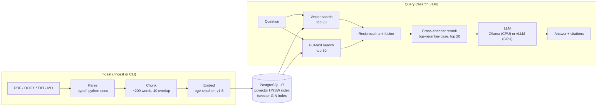

# RAG Starter

Ask questions about your own documents and get short answers that cite their
sources, with everything running on your own machine or server: PostgreSQL,
the models and the API. No document text or question is sent to an outside AI
service.

```bash
docker compose up -d --build --wait
```

## What's inside

- **One command to run.** Docker Compose starts PostgreSQL with pgvector, an
  Ollama model server and the FastAPI service.
- **Hybrid retrieval.** Semantic search (pgvector) and keyword search
  (PostgreSQL full-text) run side by side, are merged with reciprocal rank
  fusion, and the shortlist is re-scored by a cross-encoder reranker.
- **Answers with citations.** `/ask` returns the answer with numbered
  references to the file, page and passage it used.
- **PDF, Word, text and Markdown ingestion** with sentence-aligned chunking,
  page numbers for PDFs, header and footer removal, and skip-if-unchanged.
- **CPU by default, GPU when you have one.** Ollama runs a small model on CPU;
  a `gpu` profile switches generation to vLLM on an NVIDIA GPU.
- **Measured, not guessed.** An evaluation script compares vector-only,
  hybrid and hybrid + rerank retrieval on a labelled question set.
- **Private by default.** Embedding and reranker models are baked into the
  image (no Hugging Face calls at runtime), the API listens on localhost only,
  and every data endpoint needs an API key.

## Architecture



| Step | What happens | Where |
|---|---|---|
| Parse | Text is pulled from each file. PDFs keep page numbers; running headers, footers and page numbers are dropped. | [`app/loaders.py`](app/loaders.py) |
| Chunk | Whole sentences are packed into chunks of up to 200 words, and each chunk repeats up to 40 words from the previous one so facts on a boundary stay in one piece. | [`app/chunking.py`](app/chunking.py) |
| Store | Each chunk is stored once with two indexes: a pgvector embedding (HNSW, cosine) and a generated `tsvector` column (GIN). | [`app/db.py`](app/db.py) |
| Retrieve | Vector and full-text results are merged with reciprocal rank fusion, which uses ranks only, so the two scores never need to be on the same scale. | [`app/retrieval.py`](app/retrieval.py), [`app/fusion.py`](app/fusion.py) |
| Rerank | A cross-encoder reads the question and each shortlisted passage together and re-orders them. | [`app/models.py`](app/models.py) |
| Answer | The top passages go to the LLM with numbered labels; the model must cite them as `[1]`, `[2]` and say so when the answer is not in the documents. | [`app/llm.py`](app/llm.py) |

Ollama and vLLM both expose the same OpenAI-compatible chat API, so switching
between them changes a URL and a model name, not code.

## Quickstart

You need Docker with Compose v2.24 or newer, about 8 GB of memory available to
Docker and about 20 GB of free disk (the Ollama image alone is 7 GB).

**1. Start the stack**

```bash
git clone https://github.com/akshanttyagi/rag-starter.git
cd rag-starter
docker compose up -d --build --wait
```

The first run pulls PostgreSQL and Ollama, builds the API image (CPU PyTorch
plus the embedding and reranker models, 4.3 GB on disk) and downloads the chat
model into Ollama. Expect 10 to 30 minutes on a fast connection. `--wait`
returns once every service reports healthy; follow progress with
`docker compose logs -f api`. Later starts take seconds.

**2. Ingest the sample documents**

```bash
docker compose exec api python -m app.ingest samples
```

```text
file                                     status     chunks pages   secs
elements-of-style.docx                   ingested       77         9.25
nist-csf-2.0.pdf                         ingested       60    32   9.95
us-constitution.txt                      ingested       50         4.26
```

Running it again prints `unchanged` for each file.

**3. Ask a question**

```bash
curl -s http://localhost:8000/ask \
  -H "X-API-Key: change-me" -H "Content-Type: application/json" \
  -d '{"question": "What is the minimum age to become President?"}'
```

The answer cites its sources by number, and `citations` holds every passage
the model was given, with `cited` marking the ones it used (trimmed here):

```json
{
  "question": "What is the minimum age to become President?",
  "answer": "The minimum age to become President is thirty-five years [1].",
  "citations": [
    {
      "ref": 1,
      "cited": true,
      "source": "us-constitution.txt",
      "title": "The Constitution of the United States",
      "page": null,
      "chunk_id": 154,
      "score": 0.997542,
      "text": "... No Person except a natural born Citizen, or a Citizen of the United States, at the time of the Adoption of this Constitution, shall be eligible to the Office of President; neither shall any Person be eligible to that Office who shall not have attained to the Age of thirty five Years, and been fourteen Years a Resident within the United States. ..."
    },
    { "ref": 2, "cited": false, "source": "us-constitution.txt", "...": "..." }
  ],
  "model": "qwen3:4b-instruct",
  "retrieval_ms": "...",
  "generation_ms": "..."
}
```

On a laptop CPU the default 4B model takes roughly 10 to 30 seconds per
answer, most of it reading the passages. Questions the documents do not cover
get "I could not find this in the documents." instead of a guess. For faster
answers, use a GPU (see [GPU mode](#gpu-mode-vllm)) or a smaller model.

**4. Search without generating an answer**

```bash
curl -s http://localhost:8000/search \
  -H "X-API-Key: change-me" -H "Content-Type: application/json" \
  -d '{"query": "testing data backups", "mode": "rerank", "top_k": 3}'
```

`mode` is one of `vector`, `keyword`, `hybrid` or `rerank` (the default). Each
result shows its rank in the vector and keyword lists, which makes it easy to
see what each retriever contributed.

**5. Run the retrieval evaluation**

```bash
docker compose exec api python -m eval.evaluate
```

```text
Corpus: 3 documents, 187 chunks | embedder BAAI/bge-small-en-v1.5 | reranker BAAI/bge-reranker-base
Questions: 15 | top-k: 5

mode                hit@1   hit@3   hit@5     MRR  median ms
------------------------------------------------------------
vector only          0.53    0.80    0.87   0.672         26
hybrid (RRF)         0.67    0.87    0.87   0.744         22
hybrid + rerank      0.73    0.80    0.87   0.769       2656
```

It also prints the rank of the first correct chunk for every question (see
[Evaluation](#evaluation)).

Interactive API docs are at <http://localhost:8000/docs> (click **Authorize**
and enter the API key). To stop everything: `docker compose down` (add `-v` to
also delete the database and downloaded models).

## Use your own documents

Upload one or more files:

```bash
curl -s http://localhost:8000/ingest -H "X-API-Key: change-me" \
  -F "files=@report.pdf" -F "files=@handbook.docx"
```

Or copy them into `./data` (mounted read-only into the container) and run:

```bash
docker compose exec api python -m app.ingest data
```

Documents are keyed by file name. Ingesting an unchanged file does nothing; a
changed file replaces its old chunks in a single transaction. Scanned PDFs
without a text layer are skipped with a message: run OCR on them first.

## API

All endpoints except `/health` need the `X-API-Key` header.

| Method and path | Purpose |
|---|---|
| `GET /health` | Readiness of the database, models and LLM, plus document and chunk counts. Returns 503 until everything is ready. |
| `GET /documents` | Ingested documents with page and chunk counts. |
| `DELETE /documents/{source}` | Remove a document and its chunks. |
| `POST /ingest` | Multipart upload of one or more files (`files` field). |
| `POST /search` | `{"query", "mode", "top_k"}`: ranked chunks with scores and per-retriever ranks. |
| `POST /ask` | `{"question", "top_k"}`: answer, citations (`ref`, `cited`, `source`, `page`, `text`) and timings. |

## Configuration

Copy `.env.example` to `.env` and edit. Every setting has a working default.

| Variable | Default | Notes |
|---|---|---|
| `API_KEY` | `change-me` | Sent by clients as `X-API-Key`. Change it. |
| `API_PORT` | `8000` | Host port, bound to `127.0.0.1`. |
| `POSTGRES_PASSWORD` | `rag` | Database password (the database is not published on the host). |
| `OLLAMA_MODEL` | `qwen3:4b-instruct` | Any chat model from the Ollama library, pulled on first start. The default needs about 5 GB of RAM. `qwen2.5:1.5b` is faster and smaller but cites less reliably; `qwen2.5:7b` answers better if you have the memory. |
| `EMBED_MODEL` | `BAAI/bge-small-en-v1.5` | Baked into the image: rebuild after changing. A different vector size needs a fresh database (`docker compose down -v`). |
| `RERANK_MODEL` | `BAAI/bge-reranker-base` | Baked into the image: rebuild after changing. |
| `CHUNK_WORDS` / `CHUNK_OVERLAP_WORDS` | `200` / `40` | Chunk size and overlap, in words. Re-ingest after changing. |
| `TOP_K` | `5` | Default number of `/search` results. |
| `CANDIDATES` | `30` | Results taken from each retriever before fusion. |
| `RERANK_CANDIDATES` | `20` | Fused results the cross-encoder re-scores. |
| `RRF_K` | `60` | Reciprocal rank fusion constant. |
| `MAX_UPLOAD_MB` | `25` | Per-file upload limit for `/ingest`. |
| `LLM_PROVIDER` | `ollama` | `ollama` or `vllm`. |
| `VLLM_MODEL` | `Qwen/Qwen2.5-7B-Instruct-AWQ` | Hugging Face model served by vLLM in GPU mode. |

## GPU mode (vLLM)

On a Linux host with an NVIDIA GPU and the
[NVIDIA Container Toolkit](https://docs.nvidia.com/datacenter/cloud-native/container-toolkit/latest/install-guide.html),
add these two lines to `.env`:

```bash
COMPOSE_PROFILES=gpu
LLM_PROVIDER=vllm
```

Then run the same `docker compose up -d --build --wait`. The `vllm` service
downloads and serves `VLLM_MODEL` (the default 7B AWQ model needs about 10 GB
of VRAM; use `Qwen/Qwen2.5-1.5B-Instruct` on smaller cards) and the API sends
generation there. Retrieval stays on CPU, and the Ollama container keeps
running idle.

> The CPU path is what the quickstart and the evaluation above were run on.
> The GPU profile has only been checked with `docker compose --profile gpu config`
> so far; test it on your GPU host before relying on it.

## Evaluation

[`eval/questions.jsonl`](eval/questions.jsonl) holds 15 questions over the
three sample documents. Each names the file that answers it and a short phrase
from the passage that does; a retrieved chunk is a hit when it comes from that
file and contains the phrase. [`eval/evaluate.py`](eval/evaluate.py) runs every
question through `/search` in each mode and reports:

- **hit@k**: share of questions with a correct chunk in the top k results
- **MRR**: mean reciprocal rank of the first correct chunk (1.0 means it was always first)

Results on the sample documents (Apple M5 laptop, Docker Desktop with 10
CPUs and 8 GB; timings vary with hardware and load):

| Mode | hit@1 | hit@3 | hit@5 | MRR | Median latency |
|---|---|---|---|---|---|
| Vector only | 0.53 | 0.80 | 0.87 | 0.672 | 26 ms |
| Hybrid (vector + full-text, RRF) | 0.67 | 0.87 | 0.87 | 0.744 | 22 ms |
| Hybrid + rerank | **0.73** | 0.80 | 0.87 | **0.769** | 2.7 s |

What the numbers say:

- **Hybrid matches or beats vector-only on every measure here.** Full-text search catches
  exact wording that the small embedding model ranks lower, for example the
  Constitution's "twenty five Years" for the House age question (vector rank 4,
  hybrid rank 2).
- **The reranker puts the right passage first most often** (11 of 15
  questions, against 8 for vector-only), which matters most for `/ask`, since
  the model reads the top passages. It is not free: on CPU it adds about 2.5 s
  per query, and it occasionally demotes a correct passage (it moved the
  "all right" answer from rank 1 to rank 5). `RERANK_CANDIDATES` trades speed
  against depth.
- **Two questions miss in every mode**, and both are vocabulary gaps: asking
  about "suppliers" when the text says "supply chain risk management", and
  about "a comma before *and* in a list" when the rule speaks of "a series of
  three or more terms with a single conjunction". Larger embedding and reranker
  models, or query rewriting, are the usual next steps.
- Fifteen questions is a small set: one question moves a hit rate by 0.07, so
  treat small differences as noise.

Add your own questions in the same format to measure retrieval on your
documents before and after changing chunk size, models or candidate counts.
Use `--modes keyword,vector,hybrid,rerank` to include full-text search on its
own, and `--json results.json` to save per-question ranks.

## Project layout

```
app/
  main.py        FastAPI app: /health, /documents, /ingest, /search, /ask
  ingest.py      ingestion pipeline and CLI (python -m app.ingest)
  loaders.py     PDF, DOCX, TXT and MD parsing
  chunking.py    sentence-aligned chunking with overlap
  retrieval.py   vector, full-text, hybrid and reranked search
  fusion.py      reciprocal rank fusion
  models.py      embedding model and cross-encoder
  llm.py         prompt, citation parsing, Ollama / vLLM client
  db.py          schema and connection pool
  config.py      settings from environment variables
eval/            question set and evaluation script
samples/         public-domain sample documents
tests/           unit tests (no database or models needed)
```

Run the unit tests and linter without Docker:

```bash
pip install -r requirements-dev.txt
pytest -q && ruff check .
```

## Before production

This is a starter, not a finished product. Things to add for real use:

- **Secrets and TLS.** Set a strong `API_KEY` and `POSTGRES_PASSWORD`, and
  put a reverse proxy with TLS in front of the API. The API only listens on
  `127.0.0.1` until you change that.
- **Access control.** Every key sees every document. Add per-user or
  per-group filters to the retrieval queries if documents have different
  audiences.
- **Background ingestion.** `/ingest` works synchronously, which is fine for
  a few files at a time. Use a job queue for large batches.
- **OCR** for scanned PDFs, and loaders for any other formats you need.
- **Backups** of the `pgdata` volume (`pg_dump`), and monitoring of `/health`.

## Sample documents

Three public-domain documents, one per main format, chosen to look like a small
mixed document store: a technical framework with many similar sections, a legal
text with precise numbers and old spelling ("chuse", "defence"), and a style
guide made of rules and examples.

| File | Content | Source |
|---|---|---|
| `samples/nist-csf-2.0.pdf` | *The NIST Cybersecurity Framework (CSF) 2.0*, NIST CSWP 29 (2024), 32 pages | [nvlpubs.nist.gov](https://nvlpubs.nist.gov/nistpubs/CSWP/NIST.CSWP.29.pdf), unmodified. A U.S. federal government work, not subject to copyright in the United States. |
| `samples/us-constitution.txt` | The U.S. Constitution, the Bill of Rights and Amendments XI to XXVII | National Archives transcriptions ([Constitution](https://www.archives.gov/founding-docs/constitution-transcript), [Bill of Rights](https://www.archives.gov/founding-docs/bill-of-rights-transcript), [Amendments 11-27](https://www.archives.gov/founding-docs/amendments-11-27)), joined into one file. Public domain. |
| `samples/elements-of-style.docx` | William Strunk Jr., *The Elements of Style* (1920), chapters I to VI | Text from [Project Gutenberg eBook #37134](https://www.gutenberg.org/ebooks/37134), converted to Word with headings and italics kept. Published 1920, public domain in the United States. |

## License

MIT, see [LICENSE](LICENSE). The sample documents are in the public domain (see
above). The default models have their own licenses: bge-small-en-v1.5 and
bge-reranker-base (MIT), Qwen3-4B-Instruct-2507 and Qwen2.5-7B-Instruct-AWQ
(Apache 2.0).
